# apps/mobile

Aplikacja Expo (SDK 58, expo-router) dla wykonawcy: konfiguracja połączenia z serwerem, lista projektów i czat z asystentem, który zna projekt. Asystent pokazuje rysunki (`show_page`) z powiększaniem palcami, a źródła „str. N” w odpowiedziach otwierają stronę. Zakładka „Projekt” pokazuje wszystkie strony dokumentacji i pozwala zapisać je na telefonie, żeby działały bez zasięgu. Zestawienia (parametry, materiały, kroki prac, warstwy przegród) agent pokazuje jako powierzchnie A2UI, rysowane natywnie.

## Zestawienia A2UI

Renderer A2UI z CopilotKit jest tylko webowy, więc aplikacja ma własny, natywny, dla podzbioru katalogu:

- Agent wywołuje `render_a2ui`, a middleware A2UI w runtime zamienia to na wiadomość aktywności `a2ui-surface` (status „building”/„retrying”/„failed” albo lista operacji v0.9). `src/lib/a2ui.ts` odtwarza operacje (`createSurface`, `updateComponents`, `updateDataModel`, `deleteSurface`), rozwiązuje powiązania `{ path }` (także względne w szablonach list) i sprawdza pozycje list, odrzucając błędne zamiast wywracać całą powierzchnię.
- `src/components/a2ui/`: komponenty budowlane z katalogu serwera (`ParameterCard`, `MaterialList`, `WorkSteps`, `LayerComparison`) i część podstawowego katalogu potrzebna do układu (`Card`, `Column`, `Row`, `List`, `Text`, `Divider`, `Image`). Przegrody stoją jedna pod drugą, a nie obok siebie, bo telefon jest wąski. Link „str. N” otwiera stronę na pełnym ekranie (z telefonu, jeśli jest zapisana).
- Komponenty interaktywne (przyciski, pola, akcje do agenta) nie są obsługiwane. Pokazuje się wtedy krótka informacja zamiast elementu.
- Test w `a2ui.test.ts` pilnuje, żeby lista komponentów aplikacji zgadzała się z katalogiem na serwerze (`apps/server/src/a2ui-catalog.ts`).

| Budowanie | Zestawienie | Warstwy | Źródło |
|---|---|---|---|
| 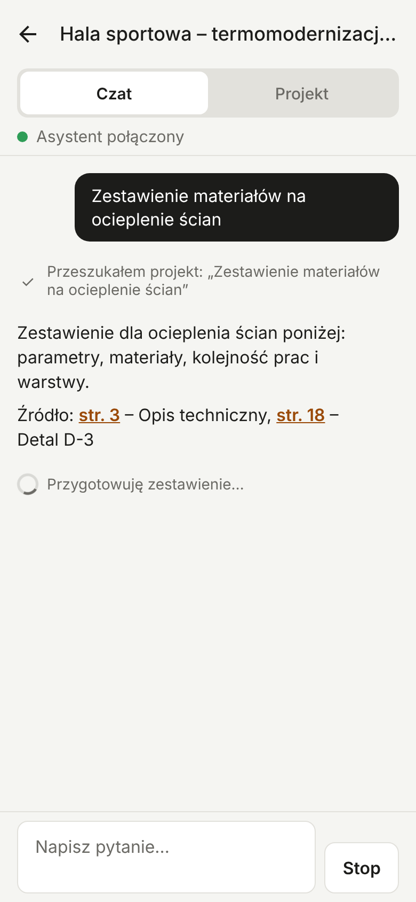 | 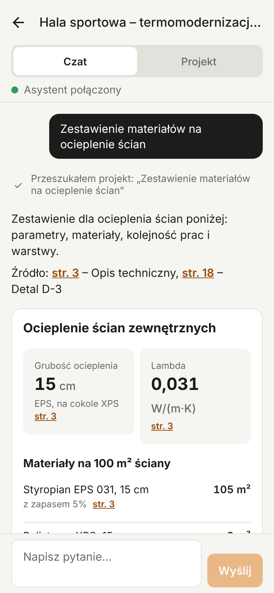 | 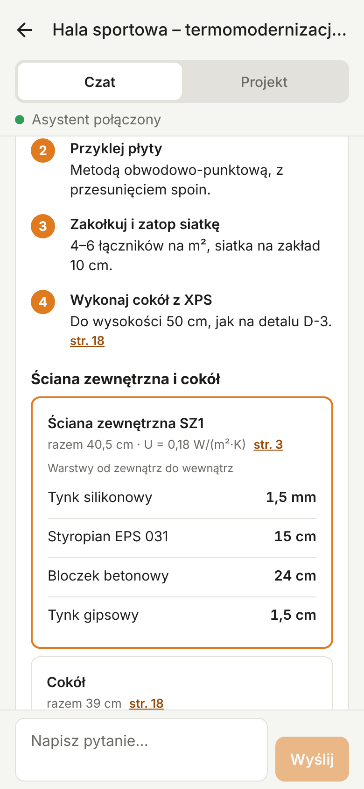 | 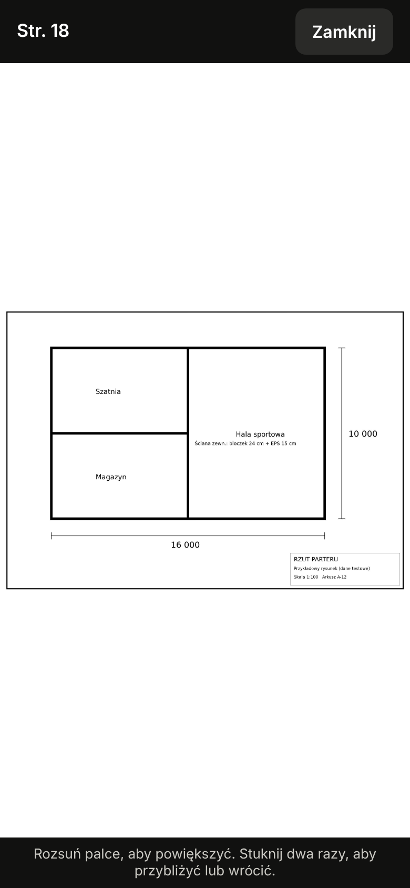 |

## Strony offline

- Zakładka „Projekt” (`GET /api/documents/:id/pages`): miniatury wszystkich stron, dotknięcie otwiera pełny ekran z powiększaniem i przyciskami „Poprzednia” / „Następna”.
- „Pobierz N stron na telefon” zapisuje obrazy stron w katalogu dokumentów aplikacji (`expo-file-system`, `Paths.document/offline/<serwer>/pages/<dokument>/<nr>.jpg`), po 3 naraz, z paskiem postępu i przerwaniem. Katalog dokumentów, a nie cache, bo system może opróżnić cache akurat wtedy, gdy telefon jest na budowie.
- Każda strona obejrzana z zasięgiem (w czacie albo w zakładce) też trafia na telefon.
- Lista projektów, dokumentów i spis stron są zapisywane przy każdym udanym pobraniu. Bez zasięgu aplikacja pokazuje ostatnią zapisaną wersję z informacją „Brak połączenia z serwerem”. Błędy serwera (np. wygasła sesja) nie są ukrywane.
- „Usuń zapisane strony z telefonu” zwalnia miejsce.
- W przeglądarce obrazy stron nie są zapisywane (`offlineCache.web.ts`), zawsze idą z serwera. Listy i tekst do wyszukiwania trafiają do `localStorage`.

## Zdjęcia przypięte do rzutu (#70)

- Na pełnym ekranie strony przycisk „Przypnij zdjęcie”, potem stuknięcie w miejsce na rysunku (także po powiększeniu). Pinezka zapisuje punkt we współrzędnych strony (0..1), więc trzyma się rysunku przy każdym powiększeniu i na każdym ekranie.
- Do pinezki: zdjęcia z aparatu albo galerii (`expo-image-picker`, w Expo Go bez development builda), pomieszczenie i notatka. Notatkę głosową dyktuje się mikrofonem klawiatury telefonu.
- Stuknięcie pinezki pokazuje jej zdjęcia, datę, autora i notatkę; można dodać kolejne zdjęcia, poprawić opis, usunąć zdjęcie albo całą pinezkę. Na kafelkach w zakładce „Projekt” widać, ile pinezek ma strona.
- Bez zasięgu wszystko działa: zmiany trafiają do kolejki na telefonie (`src/lib/pins.ts`, zapis jak inne dane offline), a zdjęcia są od razu kopiowane do katalogu dokumentów aplikacji. Kolejka wysyła się po każdej zmianie, po powrocie aplikacji na pierwszy plan i co minutę, dopóki coś czeka. Pinezka niewysłana jest półprzezroczysta i ma dopisek „Zapisane na telefonie”. Zmiana, której serwer nie przyjmie (np. za duże zdjęcie), wypada z kolejki zamiast blokować resztę.
- Asystent znajduje zdjęcia (`search_photos`), np. „pokaż zdjęcia instalacji w łazience przed zakryciem”; w czacie pokazują się miniatury, a dotknięcie otwiera rysunek z tą pinezką.
- W przeglądarce (/app) zdjęcie zrobione bez zasięgu czeka w pamięci karty: po odświeżeniu strony przepada (pinezka i notatka zostają).

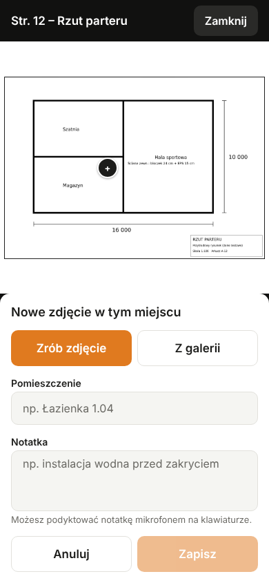 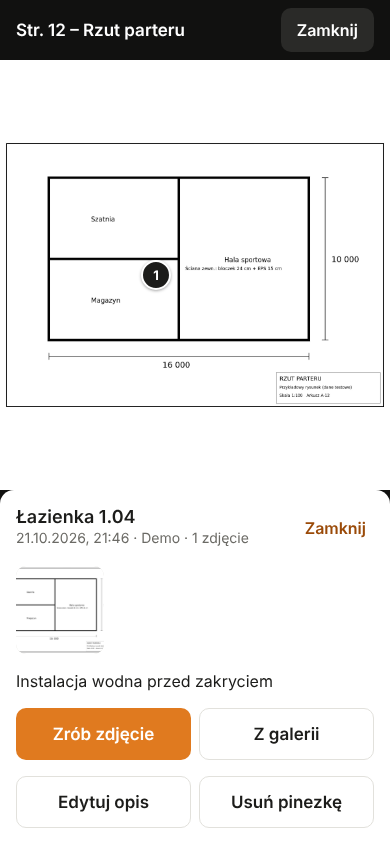 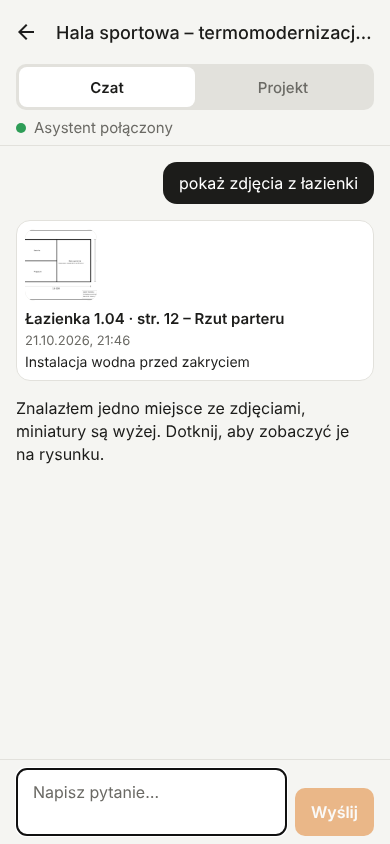

Test na serwerze testowym: pinezki i zdjęcia trzyma w pamięci, pytanie ze słowem „zdjęcia” wywołuje `search_photos`.

## Wyszukiwanie bez zasięgu (#54)

- Pole „Szukaj w projekcie” nad stronami w zakładce „Projekt”. Szuka w tekście wszystkich stron projektu (`GET /api/projects/:id/search-index`: tytuł, słowa kluczowe, streszczenie, tekst PDF), który aplikacja pobiera i zapisuje przy każdym otwarciu projektu z zasięgiem.
- Całe wyszukiwanie dzieje się w telefonie (`src/lib/search.ts`, bez modułów natywnych, więc działa w Expo Go i w /app): odmiana przez skracanie słów jak na serwerze, wielkość liter i polskie znaki bez znaczenia („cokol” znajdzie „cokół”), oznaczenia rysunków („rys. A-04”, „A04”, „D-3”) dopasowywane w całości.
- Bez zasięgu nad wynikami jest informacja, z kiedy jest kopia. Dotknięcie wyniku otwiera stronę (z telefonu, jeśli była zapisana).

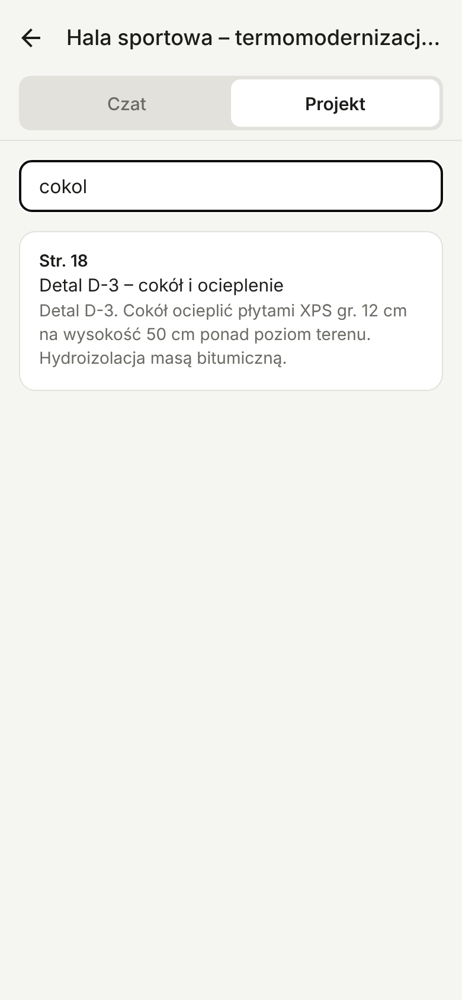 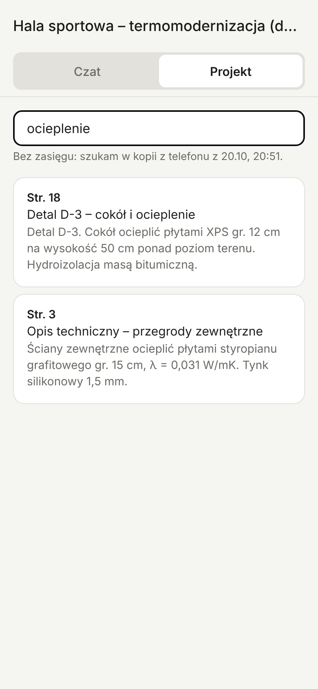

Jak sprawdzić na telefonie: otwórz projekt, zakładka „Projekt”, „Pobierz … na telefon”, włącz tryb samolotowy, zamknij i otwórz aplikację, wejdź w projekt i otwórz dowolną stronę.

## Dziennik dnia głosem (#69)

- Zakładka „Dziennik” w projekcie. Brygadzista dotyka mikrofonu i mówi pół minuty po pracy („zalaliśmy ławy, przyszła dostawa bloczków, padało od 14”). Serwer przepisuje nagranie i porządkuje wpis: wykonane prace, ludzie, dostawy, pogoda, problemy i strony projektu, których dotyczą prace. Można też wpisać tekst. Dzień wybiera się jako „Dziś” albo „Wczoraj”.
- Nagrywa `expo-audio` (jest w Expo Go): na telefonie mono AAC .m4a w katalogu dokumentów aplikacji, w przeglądarce MediaRecorder w MP4 albo Ogg. Przeglądarka nagrywająca tylko WebM (starszy Chrome) dostaje samo pole tekstowe, bo model nie przyjmuje WebM.
- Bez zasięgu nagranie czeka w kolejce na telefonie (w przeglądarce w localStorage) i wychodzi, gdy serwer odpowie: przy powrocie do aplikacji i co 30 s. Każde ma `clientId`, więc powtórka nie zdubluje wpisu.
- Historia dni, najnowszy na górze. Dotknięcie wpisu otwiera edycję wszystkich pól i daty; tekst nagrania można poprawić i uporządkować wpis od nowa.
- „Szkic do EDB” przy każdym dniu: tekst wpisu dla Elektronicznego Dziennika Budowy (GUNB) do skopiowania przez kierownika budowy. Bez integracji z EDB.

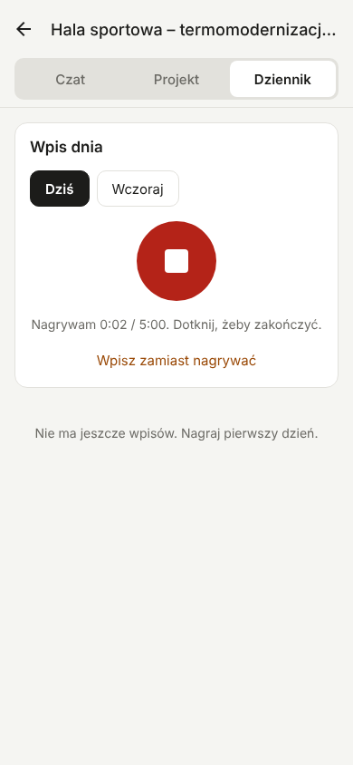 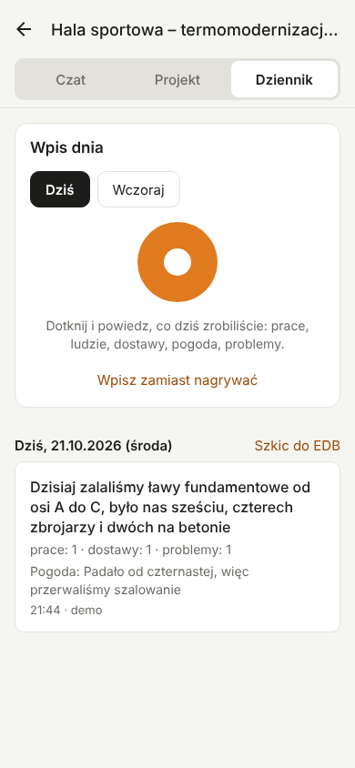 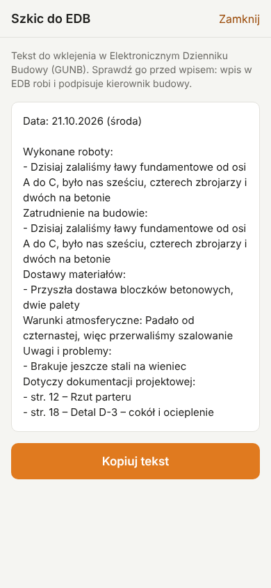

Jak sprawdzić bez klucza: serwer testowy (`pnpm --filter @brygadzista/server mock`) zapisuje dziennik w pamięci i po 2,5 s zwraca ten sam przykładowy wpis. Wpis tekstowy ze słowem „awaria” za pierwszym razem kończy się błędem, żeby sprawdzić „Spróbuj ponownie”.

## Uruchomienie

```bash
pnpm install              # w katalogu głównym repo
cd apps/mobile
pnpm start                # zeskanuj kod QR w Expo Go
```

Przy pierwszym starcie aplikacja pyta o adres serwera (np. `https://brygadzista.example.pl`), e-mail i hasło konta (#91). Konto zakłada właściciel firmy albo operator. Adres, token sesji i dane konta (firmy, aktywna firma) są w `expo-secure-store`. Sesja pracuje w jednej firmie; gdy konto należy do kilku, firmę zmienia się w „Konto” (`POST /api/auth/tenant`).

Dane zapisane na telefonie (listy, rysunki, zdjęcia, kolejki dziennika, usterek i checklist) leżą w katalogu `serwer/user-<id>/firm-<id>` (w przeglądarce: prefiks klucza `localStorage`), więc inne konto ani inna firma ich nie zobaczy. Zmiana firmy niczego nie kasuje, bo niewysłane zmiany każdej firmy czekają osobno. Wylogowanie usuwa wszystko z tego serwera, a logowanie innym kontem usuwa dane poprzednich kont i dane sprzed kont.

Podgląd w przeglądarce (`pnpm web`) służy do szybkiego sprawdzenia ekranów: na webie dane zapisują się w `localStorage`.

## Wersja w przeglądarce

Serwer serwuje aplikację pod `/app`, np. https://brygadzista.smieci.online/app. Wykonawca otwiera ten adres w przeglądarce telefonu i loguje się e-mailem i hasłem, bo adres serwera to ten sam host. Można ją dodać do ekranu głównego („Dodaj do ekranu początkowego”).

- Eksport: `pnpm export:web` (`expo export --platform web` z `EXPO_BASE_URL=/app`, wynik w `dist-web/`). Robi go Dockerfile, w osobnym etapie, więc obraz serwera nie zawiera React Native.
- Serwer czyta eksport z `MOBILE_WEB_DIR` (domyślnie `../mobile/dist-web`). Mock też go serwuje: `pnpm export:web`, potem `pnpm --filter @brygadzista/server mock` i http://localhost:3100/app/ (dowolny e-mail, hasło `demo`).
- Różnice względem Expo Go: brak zapisu obrazów stron offline (wyszukiwanie działa z kopii w `localStorage`), token sesji w `localStorage` przeglądarki, Enter wysyła pytanie (Shift+Enter to nowa linia).

## Test bez klucza OpenRouter

Serwer testowy udaje backend: prawdziwy runtime CopilotKit i pętla narzędzi, tylko model i dane są zaskryptowane (wyszukanie, `show_page` ze str. 12, odpowiedź ze źródłami). Spis stron ma 42 strony, każda z tym samym przykładowym rysunkiem.

```bash
pnpm --filter @brygadzista/server mock    # http://localhost:3100, dowolny e-mail, hasło: demo
```

W aplikacji podaj adres komputera w sieci lokalnej (np. `http://192.168.1.20:3100`; telefon musi być w tej samej sieci). Pytanie ze słowem „awaria” za pierwszym razem kończy się błędem, żeby sprawdzić komunikat i przycisk „Ponów”. Pytanie o „zestawienie” (albo materiały, warstwy, kolejność prac) zwraca powierzchnię A2UI ze wszystkimi czterema komponentami katalogu.

Testy logiki czatu: `pnpm test` (vitest).

## Struktura

```
src/app/_layout.tsx        polyfille CopilotKit, gesty, nawigacja (Stack)
src/app/index.tsx          lista projektów (GET /api/projects), przekierowanie do ustawień
src/app/settings.tsx       logowanie kontem, wybór firmy, wylogowanie
src/app/projects/[id].tsx  ekran projektu: CopilotKitProvider (nagłówki Authorization i x-project-id) + czat
src/lib/                   ustawienia, klient API, motyw, logika czatu (chat.ts) i A2UI (a2ui.ts), z testami
src/components/            przycisk, provider CopilotKit, status połączenia z agentem
src/components/a2ui/       natywny renderer A2UI: katalog budowlany i podstawowe komponenty układu
src/components/chat/       czat na useAgent, statusy narzędzi, karta show_page, pełny ekran z pinch-zoom
src/components/pages/      zakładka „Projekt”: siatka stron, pobieranie na telefon, obraz strony z telefonu lub serwera
src/lib/offline*.ts        zapis stron i danych na telefonie (expo-file-system; wersja .web: dane w localStorage)
src/lib/search.ts          wyszukiwanie w tekście projektu na telefonie, bez zasięgu
src/lib/pins.ts            pinezki ze zdjęciami: kolejka offline, synchronizacja, przeliczanie stuknięcia na punkt strony
src/lib/photoStore*.ts     kopie zdjęć na telefonie i wysyłanie (wersja .web: pamięć karty)
src/components/pins/       stan pinezek projektu, panel pinezki, wybór zdjęć, wyniki search_photos w czacie
```

## CopilotKit a Expo Go

Aplikacja importuje `@copilotkit/react-native/headless`, czyli provider i hooki bez gotowych komponentów czatu. Komponenty `CopilotChat`/`CopilotModal` korzystają z `react-native-streamdown`, który wymaga natywnego `react-native-enriched-markdown`, a tego modułu nie ma w Expo Go. Dlatego czat jest własny, na `useAgent` i `useRenderTool`, z prostym formatowaniem odpowiedzi (akapity, listy, pogrubienie, linki do stron). Działa w Expo Go. Powiększanie rysunków używa `react-native-gesture-handler` i `react-native-reanimated`, które Expo Go ma wbudowane.

Gdyby kiedyś potrzebny był gotowy `CopilotChat` (pełny Markdown, załączniki), trzeba przejść na development build (`npx expo run:android` albo EAS).
